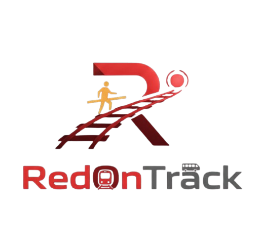

# RedOnTrack - Station Monitor

RedOnTrack is a state-of-the-art station monitoring and accident analysis dashboard designed to enhance safety and operational efficiency. Built with modern web technologies, it provides real-time surveillance capabilities, historical data analysis, and AI-driven insights.

<div align="center">
  
</div>

## 🚀 Features

*   **Live Camera Monitoring**: View and manage multiple CCTV feeds with PTZ (Pan-Tilt-Zoom) controls simulation.
*   **Accident Analysis**: Visualize accident statistics over different time periods (weekly, monthly) with interactive charts.
*   **AI-Powered Insights**: Leverage Google's Gemini API to analyze incident reports and generate actionable safety recommendations.
*   **Raw Data Catalog**: Browse and filter archived footage and incident logs.
*   **Dashboard Overview**: A centralized hub for critical metrics and system status.
*   **Authentication**: Secure login system with role-based access control (simulated).

## 🛠️ Tech Stack

*   **Framework**: [React 19](https://react.dev/)
*   **Language**: [TypeScript](https://www.typescriptlang.org/)
*   **Build Tool**: [Vite](https://vitejs.dev/)
*   **Routing**: [React Router](https://reactrouter.com/)
*   **AI Integration**: [Google Gemini API](https://ai.google.dev/)
*   **Styling**: Vanilla CSS with responsive design

## 🏗️ Architecture

This project follows a strict **SOLID** architectural pattern to ensure scalability and maintainability:

*   **Services**: Encapsulated business logic (e.g., `geminiService`, `accidentService`).
*   **Hooks**: Custom React hooks for state management and logic reuse (e.g., `useCameraManagement`).
*   **Components**: Pure presentational components.
*   **Domain**: Type definitions and interfaces.

For more details, please refer to the [Architecture Documentation](docs/ARCHITECTURE.md).

## 🏁 Getting Started

### Prerequisites

*   Node.js (v18 or higher)
*   npm or pnpm

### Installation

1.  Clone the repository:
    ```bash
    git clone https://github.com/your-username/redontrack.git
    cd redontrack
    ```

2.  Install dependencies:
    ```bash
    npm install
    ```

### Configuration

To enable AI features, you need a Google Gemini API key.

1.  Create a `.env.local` file in the root directory.
2.  Add your API key:
    ```env
    VITE_GEMINI_API_KEY=your_actual_api_key_here
    ```

### Running the Application

Start the development server:

```bash
npm run dev
```

Open [http://localhost:5173](http://localhost:5173) in your browser.

## 📂 Project Structure

```text
src/
├── services/       # Business logic (API calls, data processing)
├── domain/         # TypeScript interfaces and types
├── hooks/          # Custom React hooks
├── components/     # Reusable UI components
├── pages/          # Application pages/routes
├── utils/          # Helper functions
├── constants/      # App-wide constants
└── App.tsx         # Main application entry
```

## 🤝 Contributing

1.  Fork the repository.
2.  Create a feature branch (`git checkout -b feature/AmazingFeature`).
3.  Commit your changes (`git commit -m 'Add some AmazingFeature'`).
4.  Push to the branch (`git push origin feature/AmazingFeature`).
5.  Open a Pull Request.

---

*RedOnTrack Station Monitor - Ensuring Safety Through Intelligence.*
